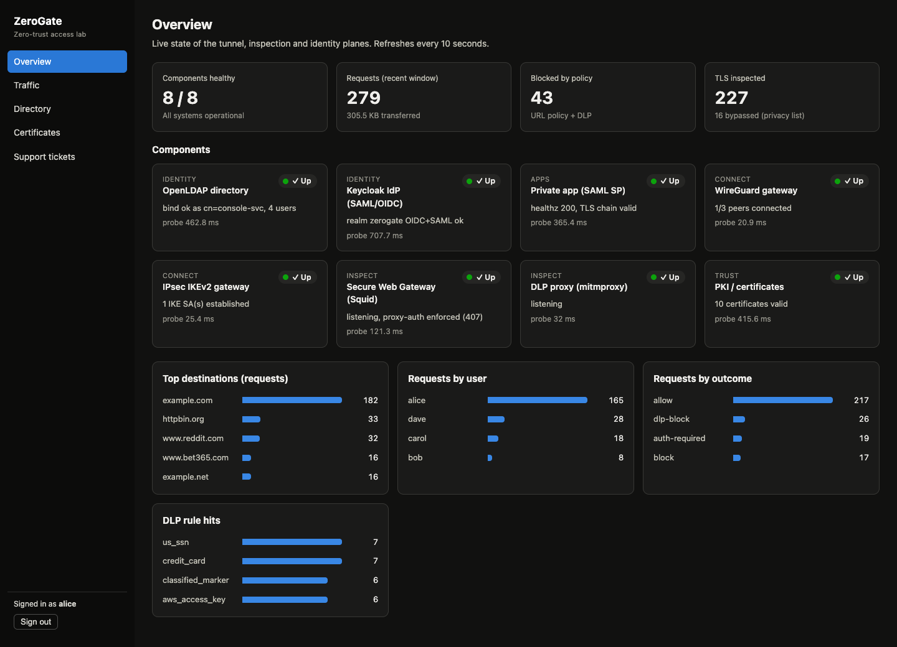
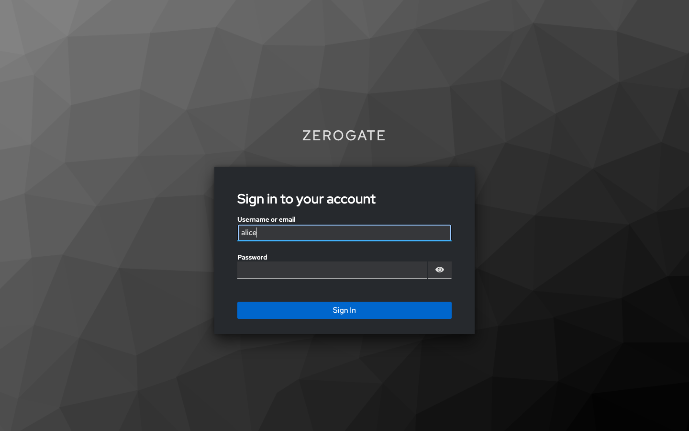
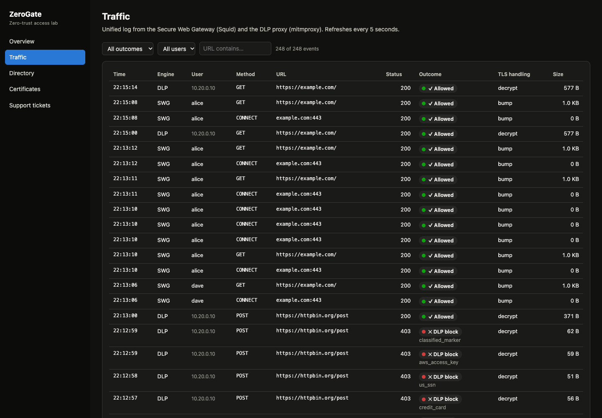
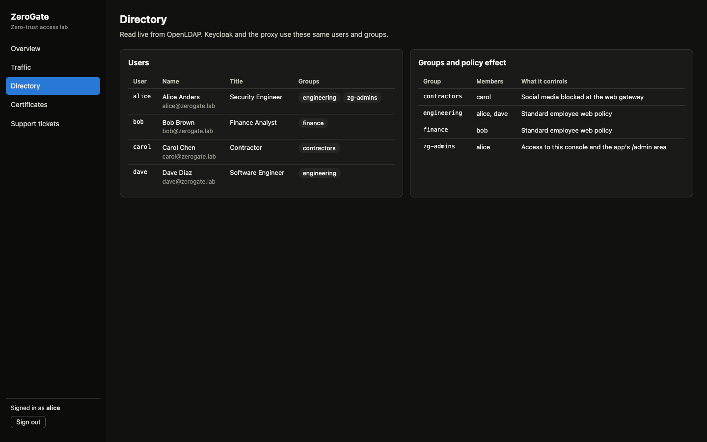
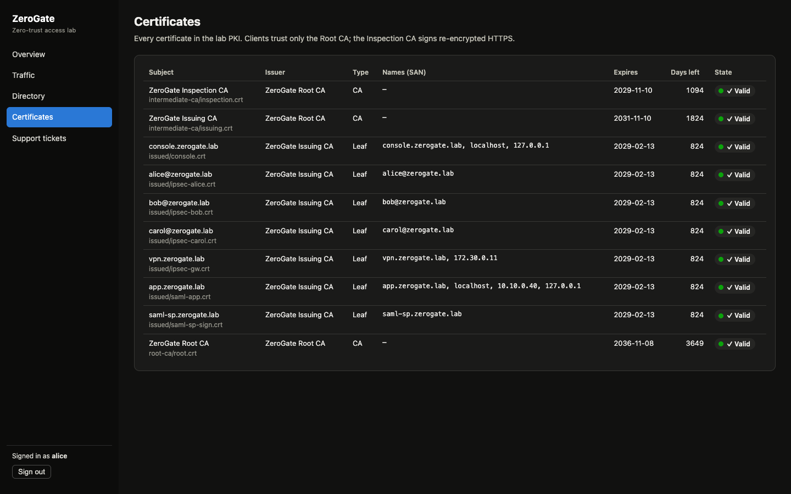
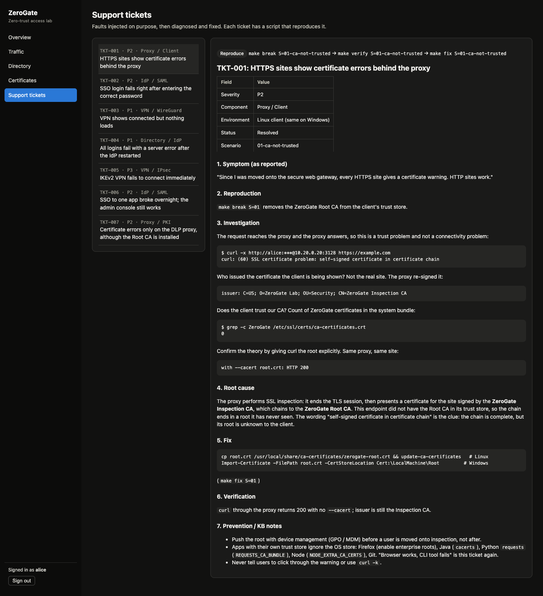

# ZeroGate — Zero-Trust Access Lab

[](https://github.com/nishanandisha/ZeroGate/actions/workflows/ci.yml)

A small, working copy of a commercial Security Service Edge (SSE) platform that runs on one laptop:
a VPN, an HTTPS-inspecting proxy with DLP, and single sign-on, with an admin console on top and a
library of break/fix support tickets that can each be reproduced with one command.

It is a lab, built to learn and demonstrate how these products work and how they fail. It is not
hardened for production use.



## What it does

| Pillar | What happens | Built with | Real-world equivalent |
|---|---|---|---|
| **Connect** | Users reach the private app only through an authenticated tunnel. Everything else on the corporate network is blocked. | WireGuard, IPsec IKEv2 (strongSwan) | Private access / tunnel connectors |
| **Inspect** | Web traffic goes through a proxy that decrypts TLS with a company CA, applies per-group policy, blocks sensitive uploads and logs every request. | Squid SSL-Bump, mitmproxy, custom 3-tier PKI | Secure web gateway with SSL inspection and DLP |
| **Identify** | One directory is the source of truth. The IdP, the proxy and the console all authenticate against it. | OpenLDAP, Keycloak (SAML + OIDC) | Directory sync + SAML SSO |
| **Control plane** | Read-only API: health probes, directory, certificate inventory, traffic log, tickets. | FastAPI, PyJWT | Admin / policy API |
| **Admin console** | Live dashboard for all of the above, behind SSO. | React, TypeScript, Vite, nginx | Admin portal |
| **Support** | Seven faults that can be injected, diagnosed and fixed, each with a written ticket. | Bash scenarios + Markdown write-ups | Customer support / TAC cases |

## Architecture

Eleven containers on three Docker networks. Tunnel users land in the edge network and may reach only the
private app and the two proxies.

```
  public 172.30.0.0/24 ("the internet")
    client-wg ──── WireGuard UDP/51820 ───► vpn-gw
    client-ipsec ─ IKEv2 UDP/500,4500 ────► ipsec-gw
                                              │ tunnels 10.99.0.0/24 and 10.98.0.0/24
  edge / DMZ 10.20.0.0/24                     ▼
    vpn-gw · ipsec-gw · squid (SSL-Bump + LDAP auth) · mitmproxy (DLP) ──► real internet
                                              │
  corp 10.10.0.0/24                           ▼
    openldap · keycloak · saml-app (private app) · backend (API) · frontend (console)
```

Trust model: an offline Root CA signs an Issuing CA (server and client certificates) and an Inspection CA
(used by the proxies to re-sign HTTPS). Clients trust only the root.

Full topology, IP plan and design decisions: [docs/architecture/ARCHITECTURE.md](docs/architecture/ARCHITECTURE.md).

## Proof of work: the admin console

All screenshots were taken from the running lab on 2026-11-11, signed in as the lab admin `alice`.
Every user, address and domain shown is lab test data.

**Single sign-on.** The console has no login form of its own. It redirects to Keycloak (OIDC
Authorization Code + PKCE), which checks the password against OpenLDAP.



**Traffic.** One log merged from the web gateway and the DLP proxy. It shows allowed requests, policy
blocks, proxy-auth challenges, and uploads stopped by a DLP rule (card number, SSN, AWS key,
classification marker).



**Directory.** Users and groups read live from OpenLDAP, with the policy each group drives.



**Certificates.** Inventory of the lab PKI with issuer, SANs, expiry and days left.



**Support tickets.** Each ticket follows symptom → reproduction → investigation → root cause → fix →
verification → prevention, and names the command that reproduces it.



## Test results

Measured on 2026-11-11 against the running lab (11 containers, Docker Desktop, Apple Silicon).

| Suite | Command | Cases | Passed | Failed | Run time |
|---|---|---|---|---|---|
| Backend unit tests | `make unit` | 16 | 16 | 0 | 0.9 s |
| Integration tests (live lab) | `make integration` | 30 | 30 | 0 | 28 s |
| Leak and exposure tests | `make security` | 20 | 20 | 0 | 2.8 s |
| Break/fix scenarios | `make breakfix` | 7 | 7 | 0 | 2 min 5 s |
| **Total** | | **73** | **73** | **0** | about 2 min 37 s |

Also clean: `ruff` on the backend and the security tests, and the frontend type-check and production build.

The same suites run in GitHub Actions on every push ([workflow](.github/workflows/ci.yml)): lint and unit
tests, frontend build, shellcheck / compose / Terraform validation, then the whole lab is built from a
clean clone and the integration, leak and break/fix suites run against it. All four jobs pass.

**What the integration tests prove (30 cases)**

| Area | Cases | Examples |
|---|---|---|
| VPN and segmentation | 11 | Both tunnels reach the private app; 6 unpublished ports are blocked; IPsec uses AES-GCM-256; the status feed leaks no keys |
| Web inspection and DLP | 12 | HTTPS is decrypted and trusted; the proxy needs a login; contractor vs employee policy; 4 sensitive-upload patterns blocked; privacy category not decrypted |
| Identity and SSO | 4 | SAML login carries LDAP groups; bad password rejected; `/admin` limited by group; token claims come from LDAP |
| Control plane | 3 | All 8 health probes green; the API needs a token and the admin group; every ticket links to a scenario |

**Break/fix scenarios (7 of 7 detected, 7 of 7 recovered)**

| Scenario | Ticket | Result | Detect (s) | Fix + verify (s) | Whole cycle (s) |
|---|---|---|---|---|---|
| CA not trusted | [TKT-001](tickets/resolved/TKT-001-ca-not-trusted.md) | PASS | 0 | 1 | 3 |
| SAML clock skew | [TKT-002](tickets/resolved/TKT-002-saml-clock-skew.md) | PASS | 2 | 16 | 32 |
| VPN up, no traffic | [TKT-003](tickets/resolved/TKT-003-vpn-up-no-traffic.md) | PASS | 4 | 2 | 15 |
| LDAP bind failure | [TKT-004](tickets/resolved/TKT-004-ldap-bind-failure.md) | PASS | 1 | 1 | 26 |
| IPsec proposal mismatch | [TKT-005](tickets/resolved/TKT-005-ipsec-proposal-mismatch.md) | PASS | 0 | 5 | 10 |
| IdP key rotation | [TKT-006](tickets/resolved/TKT-006-idp-key-rotation.md) | PASS | 1 | 13 | 24 |
| Missing intermediate | [TKT-007](tickets/resolved/TKT-007-missing-intermediate.md) | PASS | 0 | 5 | 15 |

These are script timings with the fault and fix already known, not human response times.

Full numbers, unit-test coverage (about 73% of `backend/app`) and captured evidence:
[testing/reports/test-metrics.md](testing/reports/test-metrics.md),
[testing/reports/break-fix-report.md](testing/reports/break-fix-report.md),
[testing/reports/evidence/](testing/reports/evidence/).

**Not covered by any test:** the frontend has no component or browser tests (pages were checked by hand);
the Windows client scripts have never been run; the AWS Terraform is validated only, never applied;
there is no load or concurrency testing.

## Security: what is checked so nothing leaks

`make security` runs 20 checks in [testing/security/test_no_leaks.py](testing/security/test_no_leaks.py).
All 20 pass.

| Area | Cases | What is asserted |
|---|---|---|
| Repository | 4 | Nothing git would publish is a key, `.env`, Terraform state or generated PKI/VPN file. No file contains a live password, a private key, a token-shaped string (AWS, GitHub, Slack, Google, JWT) or a local home path. `.env.example` holds placeholders only. |
| API | 12 | Only `/api/health/live` and `/api/auth/config` answer without a token. A missing, garbage or `alg: none` token gets 401 on every other route. A valid non-admin user gets 403 on every route. No write methods exist. Responses to an admin contain no passwords, keys, tokens or sensitive field names. Directory users expose only `uid`, `name`, `email`, `title`, `groups`. Errors show no stack traces or file contents. CORS rejects foreign origins. Responses are `no-store`. |
| Console | 4 | nginx serves no dotfiles, keys or config files. The JavaScript bundle contains no secrets and no source maps. `X-Frame-Options`, `X-Content-Type-Options`, `Referrer-Policy` and a Content Security Policy are set. The `/api` proxy enforces auth too. |

**How secrets are kept out of the repository**

- Passwords live only in `infrastructure/.env`, which is git-ignored. `.env.example` contains
  `change-me-...` placeholders, and no script or test has a built-in default password.
- All PKI material (root, intermediates, issued certificates and keys) and all WireGuard keys are generated
  locally by `make init` and git-ignored.
- Break/fix evidence is passed through a redaction filter (passwords, local paths) before it is written.
- Access tokens are held by the console in `sessionStorage` only and are never logged by the API.

**Known limits (lab scope)**

- The interactive API docs (`/api/docs`, `/api/openapi.json`) are public. They describe the routes but
  return no data.
- Keycloak, the API and the console are served over plain HTTP on `localhost`. Only the private app uses TLS.
- Published ports bind to all host interfaces, so the lab is reachable from the local network while it runs.
  Change the passwords in `infrastructure/.env` before starting it on a shared network.
- The `zerogate-cli` Keycloak client allows the password grant. It exists for the test suite.
- `npm audit` reports 2 moderate advisories in `react-router-dom` 6; the fix is a major-version upgrade
  and has not been done.

## Quick start

Needs Docker Desktop (4 GB RAM), Python 3.12 and `make`.

```bash
make init          # creates infrastructure/.env from .env.example, builds the PKI and the test virtualenv
                   # now edit infrastructure/.env and replace every change-me-... password
make up            # builds and starts 11 containers (first run takes several minutes)
make demo          # tunnel, segmentation and inspection from the Linux client
make test          # 16 unit + 30 integration + 20 leak tests
make breakfix      # breaks and repairs the lab 7 ways, writes a report
```

| What | URL |
|---|---|
| Admin console | http://localhost:3300 (sign in as `alice`, password = `LAB_USER_PASSWORD`) |
| Private app (SAML) | https://localhost:8443 |
| Keycloak | http://localhost:8080 |
| API docs | http://localhost:8800/api/docs |

Lab users: `alice` (engineering, console admin), `bob` (finance), `carol` (contractor), `dave` (engineering).

### All make targets

| Target | What it does |
|---|---|
| `make init` | Create `infrastructure/.env`, the PKI and the test virtualenv |
| `make up` / `down` / `destroy` | Start the lab / stop it / stop it and delete its volumes |
| `make ps`, `make logs S=<service>` | Container status, follow logs |
| `make unit` | Backend unit tests and lint |
| `make integration` | Integration tests against the running lab |
| `make security` | Leak and exposure checks |
| `make test` | All three of the above |
| `make scenarios` | List the break/fix scenarios |
| `make break S=03`, `diagnose`, `fix`, `verify`, `cycle` | Run one step of one scenario |
| `make breakfix` | Cycle every scenario and write the report |
| `make demo` | Client-side demo |

## Repository layout

```
docs/            Architecture, roadmap, runbook, stage reports, screenshots
infrastructure/  The lab: PKI, VPN, proxy, identity, protected app, clients, cloud (Terraform)
backend/         FastAPI control plane (health probes, directory, PKI inventory, traffic, tickets)
frontend/        React admin console (overview, traffic, directory, certificates, tickets)
testing/         Integration, security and e2e tests, break/fix scenarios, reports
tickets/         Support-ticket write-ups (symptom → investigation → root cause → fix)
scripts/         Bootstrap / helper scripts
.github/         CI workflow
```

## Read next

- [Architecture](docs/architecture/ARCHITECTURE.md): topology, IP plan, trust model, design decisions
- [Runbook](docs/runbooks/RUNBOOK.md): operations, where to look first, known limits
- [Support tickets](tickets/resolved/): 7 break/fix write-ups
- [Test metrics](testing/reports/test-metrics.md): every number above, in detail
- [Interview pack](docs/INTERVIEW-PACK.md): pitch and demo script
- [Stage reports](docs/status/): how the lab was built, stage by stage
